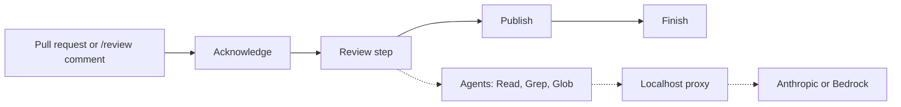

# Architecture

How code-review is built. [assurance-case.md](assurance-case.md) explains why the design meets its security
requirements.

## Components

A consumer's `.github/workflows/code-review.yml` calls the composite action in `action.yml`, which runs these steps in
one job, each a Node.js script under `src/` run directly with `node`:

| Component | Role |
| --- | --- |
| Acknowledgement (`src/acknowledge.ts`) | Within seconds, puts 👀 on a `/review` comment and the "Code review" check run in progress, with the runner's own `node` and no npm package |
| Review step (`src/main.ts`) | Gathers the diff and context, picks the provider, runs the review and writes `results.json` and `trace.json`, or `status.json` with why there's no review |
| Gather (`src/gather.ts`, `src/fetch-head.ts`, `src/writers.ts`, `src/settings.ts`) | Fetches the pull request's head only to read it, keeps only writers' text, and reads the repository's settings from the default branch |
| Provider and proxy (`src/provider.ts`, `src/credentials.ts`, `src/proxy.ts`) | Picks Anthropic while the plan's credits last, then Bedrock, and adds the credentials to each model request on localhost |
| Review pipeline (`src/context.ts`, `src/review.ts`, `src/verify.ts`, `src/rereview.ts`) | Context, selection, the reviewers in `reviewers/`, rule checks, synthesis and verification; a re-review reads only what changed |
| Agents (`src/agent.ts`) | One model call each, through the Claude Agent SDK, with `prompts/` and `guidance/`, three read-only tools and a path guard |
| Publish (`src/publish.ts`, `src/threads.ts`, `src/comments.ts`, `src/checks.ts`, `src/outputs.ts`) | Posts the review threads and summary comment, completes the check run, and scans everything it posts for secrets |
| Finish (`src/finish.ts`) | Completes the check run with why when there was no review to publish |
| Outcomes (`src/outcomes.ts`) | Records what became of each finding when the pull request closes, by rules alone |
| Training and evals (`training/`, `evals/`, `tools/`) | Offline: learn `guidance/` from NCodeGroup repositories, and measure each change to the review |

## Design Rules

- Decisions the design rests on are recorded in [decisions/](decisions/README.md).

## Build and Release

CI runs the project's commands on every pull request (`.github/workflows/ci.yml`). `AGENTS.md`'s Landing section sets
`release: tag+release`: when a pull request whose change reaches consumers merges, `.github/workflows/tag-release.yml`
tags the merge commit and publishes the release from that version's section of `CHANGELOG.md`, as
[ADR-1006](decisions/1006-a-plan-that-reaches-consumers-releases-when-its-pull-request-merges.md) records.
